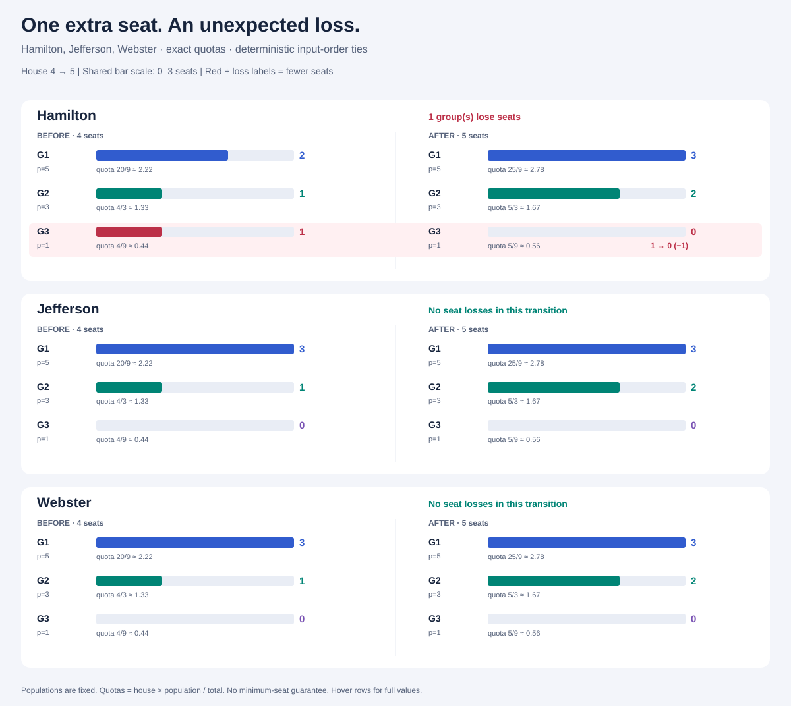

# Apportionment Paradox

A small .NET 10 laboratory for the **Alabama paradox**: increasing the total number of seats can make a group lose a seat under Hamilton's largest-remainder method.

Compare Hamilton, Jefferson, and Webster using exact integer and rational arithmetic, sweep house sizes, search deterministic population distributions, and generate standalone SVG charts. The library and CLI have no third-party runtime dependencies.



## Try it

Install the [.NET 10 SDK](https://dotnet.microsoft.com/download/dotnet/10.0). The repository selects SDK `10.0.402` or a higher installed patch in the `10.0.4xx` feature band, following the [`latestPatch` policy](https://learn.microsoft.com/en-us/dotnet/core/tools/global-json#rollforward). An older SDK or a different feature band alone does not satisfy `global.json`. Check the installed SDKs with `dotnet --list-sdks`.

Get the source:

```sh
git clone https://github.com/andrii2g/apportionment-paradox.git
cd apportionment-paradox
```

From the repository root:

```sh
dotnet build
dotnet run --project src/Apportionment.Cli -- allocate --populations 5,3,1 --seats 4
dotnet run --project src/Apportionment.Cli -- sweep --populations 5,3,1 --from 4 --to 5
dotnet run --project src/Apportionment.Cli -- search --groups 3 --max-population 5 --from 0 --to 20
dotnet run --project src/Apportionment.Cli -- visualize --populations 5,3,1 --seats 4 --output artifacts/example.svg
```

`dotnet build` restores dependencies automatically. Restoring test packages requires access to NuGet or a populated local package cache. Open `artifacts/example.svg` in a browser to inspect the comparison. The SVG is self-contained and includes full values in hover titles; open the SVG directly to use those details.

## Command reference

All commands below follow `dotnet run --project src/Apportionment.Cli --`. For help, use the complete command:

```sh
dotnet run --project src/Apportionment.Cli -- --help
```

| Command | Required options | Output |
|---|---|---|
| `allocate` | `--populations`, `--seats` | Each group's population, exact quota, allocated seats, signed deviation, and allocation totals. |
| `sweep` | `--populations`, `--from`, `--to` | Seat vectors and deviation metrics for every configuration, paradox events, and a summary. |
| `search` | `--groups`, `--max-population`, `--from`, `--to` | A limited number of paradox examples and a summary of all examined configurations. |
| `visualize` | `--populations`, `--seats`, `--output` | An SVG comparing H=`--seats` with H+1 for the selected methods. |

`--populations` takes a comma-separated list such as `5,3,1`. Commands, option names, and method names are case sensitive. Options use separate name/value arguments (`--seats 4`); `--seats=4`, duplicate options, and unknown options are rejected.

| Optional argument | Commands | Default | Accepted values |
|---|---|---|---|
| `--method` | All | `all` | `hamilton`, `jefferson`, `webster`, `all` |
| `--max-configurations` | `sweep`, `search` | `100000` | 1–1,000,000, shared across all selected methods and distributions |
| `--examples` | `search` | `10` | 0–100; limits printed events without stopping the search |

## A worked paradox

For populations **5, 3, 1**, the total population is 9:

| Group | Population | Quota at H=4 | Hamilton seats | Quota at H=5 | Hamilton seats |
|---|---:|---:|---:|---:|---:|
| G1 | 5 | 20/9 | 2 | 25/9 | 3 |
| G2 | 3 | 12/9 | 1 | 15/9 | 2 |
| G3 | 1 | 4/9 | **1** | 5/9 | **0** |

At H=4, G3 has the largest remainder and receives the one remaining seat. At H=5, G1 and G2 have the two largest remainders and receive the two remaining seats. G3 loses its seat even though its quota increases. This example has no remainder ties.

The corresponding sweep includes:

```text
PARADOX Hamilton populations=[5,3,1] H=4->5: G3: 1->0 (-1)
```

## Mathematical rules

For population `p[i]`, total population `P`, and house size `H`, the standard quota is `H * p[i] / P` for all three methods. In the divisor priorities below, `s[i]` is the group's current allocated seat count and `n` is the number of groups.

| Method | Allocation rule | Complexity per allocation |
|---|---|---|
| Hamilton | Assign quota floors; award remaining seats by descending `(H * p[i]) % P`. | O(n log n) |
| Jefferson | Start at zero seats; award each next seat to the largest `p[i] / (s[i] + 1)`. | O(n + Hn) |
| Webster | Start at zero seats; award each next seat to the largest `p[i] / (2*s[i] + 1)`. | O(n + Hn) |

These bounds count allocation operations, including initialization for H=0; the bit cost of arithmetic also depends on population size. Each method uses O(n) working storage. Sweeps currently compute each house size independently.

Webster's priority is proportional to `p[i] / (s[i] + 1/2)`. Both divisor methods use their equivalent highest-averages formulation, avoiding a numerical divisor search and rounding ambiguities at ties. A linear scan keeps the implementation easy to audit at this scale.

Population arithmetic, quota numerators, remainders, and priority cross-products use `BigInteger`. House sizes and individual seat counts use `int`; exploration counters use checked `long` arithmetic. `Rational` stores reduced fractions with positive denominators. Allocation decisions never use floating point; SVG geometry uses floating point only after allocation. Decimal quota labels use exact integer rounding, with halves rounded away from zero.

**Ties favor the first group in the original input order.** This order stays fixed across house sizes. Generated tuples retain their labels and order; permutations are separate distributions, and scale-equivalent tuples are included. Ties can therefore affect which labeled group wins, but results are deterministic.

Hamilton respects the quota rule, `floor(quota) <= seats <= ceiling(quota)`, but can lose house monotonicity. Jefferson and Webster are house monotone under the fixed tie rule; divisor methods can violate quota bounds. For example, Jefferson assigns `[4,0,0]` to populations `[6,1,1]` at H=4, even though the first group's quota is exactly 3. Quota deviation is therefore measured independently of paradox detection.

See the [Census Bureau's historical method descriptions](https://www.census.gov/topics/public-sector/congressional-apportionment/about/historical-perspective.html), [Young's discussion of fairness and paradoxes](https://www2.census.gov/about/history/historical-censuses-surveys/survey-census-history/decennial/fairness-in-apportionment-young.pdf), and [Balinski and Young's The Webster Method of Apportionment](https://pure.iiasa.ac.at/1134/1/WP-79-049.pdf).

## Sweeps, search, and metrics

`sweep` evaluates a fixed population vector at every house size in the **inclusive** range `--from` through `--to`. It prints seat vectors, exact deviation metrics, and any losses between adjacent sizes. A one-size range evaluates allocations and has no transitions.

`search` generates all labeled population tuples in `1..max-population`, lexicographically, with the last group changing fastest. The generator streams results without materializing the search space. For each tuple, methods run in Hamilton/Jefferson/Webster order, with house sizes ascending within each method.

```sh
dotnet run --project src/Apportionment.Cli -- search --groups 3 --max-population 12 --from 1 --to 30 --max-configurations 200000 --examples 5
```

The default configuration limit is **100,000**, shared across all methods and distributions. Reaching it can stop inside a method's sweep; the CLI explicitly reports partial results and per-method counts. It stops before computing an extra allocation. `--examples` limits only the number of printed search events (default 10); all observed events still count. Ctrl+C cancels work with exit code 130.

For `n` groups, maximum population `K`, and `m` selected methods, a complete search examines `K^n` distributions, `K^n * m * (to - from + 1)` allocation configurations, and `K^n * m * (to - from)` adjacent transitions. A fixed-vector sweep uses the same formulas with one distribution. Set a budget large enough for the requested work; the larger example above needs **155,520** configurations and therefore specifies `--max-configurations 200000`.

`Status: complete` means all requested work finished, including when the budget exactly matches the required configuration count. `Status: configuration limit reached; results are partial` means work remains. Partial summaries cover a deterministic prefix and may include different coverage per method; check their individual configuration and transition counts before comparing them. Each run starts again from the first tuple.

| Metric | Meaning |
|---|---|
| Population distributions examined | Tuples for which at least one allocation was computed; includes a partially examined final tuple. |
| Allocation configurations examined | One population tuple × one method × one house size. |
| Seats allocated | Sum of house sizes across a method's examined configurations. Every individual allocation checks seat conservation. |
| Adjacent transitions examined | Comparisons at H and H+1 within the same tuple and method. |
| Paradox transitions | Examined transitions with at least one group losing seats. Counted separately per method. |
| Losing group occurrences | Number of group losses across transitions, including repeated losses by the same group. |
| Seats lost | Total magnitude of those losses. |
| Quota deviation | Signed `allocated seats − standard quota`, reported per group by `allocate`. |
| Absolute deviation metrics | Per-allocation maximum and sum of absolute deviations; exploration reports the maximum observed value of each. |

The two search commands above produce these complete results with `--method all`:

| Search | Distributions | Allocations | Adjacent transitions | Hamilton paradox transitions | Jefferson | Webster |
|---|---:|---:|---:|---:|---:|---:|
| `--groups 3 --max-population 5 --from 0 --to 20` | 125 | 7,875 | 7,500 | 40 | 0 | 0 |
| `--groups 3 --max-population 12 --from 1 --to 30 --max-configurations 200000` | 1,728 | 155,520 | 150,336 | 1,001 | 0 | 0 |

Counts include ties resolved by input order, permutations, and scale-equivalent tuples. They describe bounded enumerations rather than probability estimates. A zero observed count is an experimental result; house monotonicity for the divisor methods is a mathematical property.

## Input and rendering limits

- Populations must be nonnegative integers, with a positive total. Groups are named G1, G2, … by the CLI. The library accepts unique, nonblank custom IDs.
- A house size may be zero. No method guarantees a minimum seat per group. Zero-population groups receive no seats.
- The CLI allows up to 256 groups and 256 characters per population token, and house sizes through 100,000. `--from` and `--to` are required, inclusive, and must satisfy `0 <= from <= to <= 100000`.
- Search allows 1–8 groups, maximum population 1–1,000, configuration limits 1–1,000,000, and 0–100 printed examples. Generated populations are positive; explicit inputs may contain zeros.
- SVG compares H with H+1, supports up to 16 groups, and allows H through 99,999. Bars share one scale across all panels. Losses use red plus an explicit numeric label. Long labels are abbreviated visually; full values remain in hover titles. `--output` must end in `.svg`; an existing file at that path is overwritten.
- Searches are combinatorial, and divisor allocation is linear in the house size. The configuration budget bounds allocation counts, not elapsed time. Use small ranges initially.

Commands return 0 on success, including a clearly marked budget-limited exploration; 2 for invalid arguments or file errors; and 130 for cancellation. Results go to stdout; argument/file errors and cancellation messages go to stderr. Output may already have been streamed when cancellation occurs, and a cancelled run does not print a completed exploration summary. Decimal punctuation and numeric output are culture independent.

## Use the library

Add a project reference to `src/Apportionment.Core/Apportionment.Core.csproj` from a .NET 10 application. Custom group IDs stay attached to the results:

```csharp
using Apportionment.Core;
using Apportionment.Core.Methods;

Group[] groups = [new("A", 5), new("B", 3), new("C", 1)];
IApportionmentMethod method = new HamiltonMethod();
var allocation = method.Allocate(groups, houseSize: 4);

foreach (var group in allocation.Groups)
    Console.WriteLine($"{group.Group.Id}: {group.Seats} seats; quota {group.Quota}");
// A: 2 seats; quota 20/9
// B: 1 seats; quota 4/3
// C: 1 seats; quota 4/9
```

`Allocation` exposes `Groups`, `HouseSize`, `Method`, `MaxAbsoluteQuotaDeviation`, and `TotalAbsoluteQuotaDeviation`. `GroupAllocation.QuotaDeviation` is signed. The method snapshots input groups and returns a read-only result collection.

`Experiment.Run` in `Apportionment.Core.Exploration` accepts population distributions, selected method strategies, an inclusive house range, a configuration budget, optional allocation/paradox callbacks, and a cancellation token. It retains counters and the preceding allocation rather than the entire history. `ParadoxTransition` compares the same method and ordered populations at H and H+1 and exposes the groups losing seats through `Losses`.

The library accepts `BigInteger` populations and nonnegative `int` house sizes without the CLI's group/population/house caps. It still validates population totals and IDs. Larger inputs can be expensive; aggregate counters throw on `long` overflow.

## Code and validation

`Apportionment.Core` contains immutable results, exact arithmetic, the three strategies behind `IApportionmentMethod`, deterministic generation, transition detection, and streaming experiment counters. `Apportionment.Cli` handles parsing, console presentation, and XML-based SVG rendering. Allocation methods snapshot inputs and share validation; every result checks nonnegative seats and an exact seat total.

```sh
dotnet test
dotnet test -c Release
dotnet format --verify-no-changes
dotnet publish src/Apportionment.Cli -c Release -o artifacts/publish
dotnet artifacts/publish/Apportionment.Cli.dll allocate --populations 5,3,1 --seats 4
```

The default publish is framework dependent: the receiving machine needs a .NET 10 runtime. Run the published DLL with `dotnet` as shown above.

Tests cover known examples, exhaustive small allocations, Hamilton's quota bounds, divisor house monotonicity, an independent global-priority-table oracle, ties, huge populations, scaling, invalid inputs, cancellation, exploration budgets and counters, deterministic search, XML escaping, culture independence, and SVG file generation.

Generated output belongs in ignored `artifacts/`. The checked-in `docs/example.svg` is regenerated with:

```sh
dotnet run --project src/Apportionment.Cli -- visualize --populations 5,3,1 --seats 4 --output docs/example.svg
```

No GitHub Actions or workflows are included.
